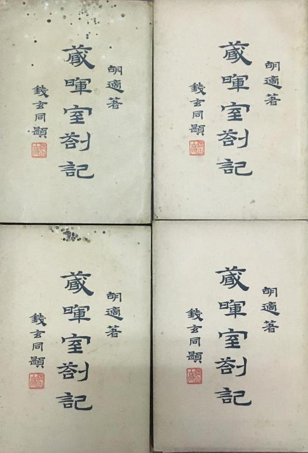
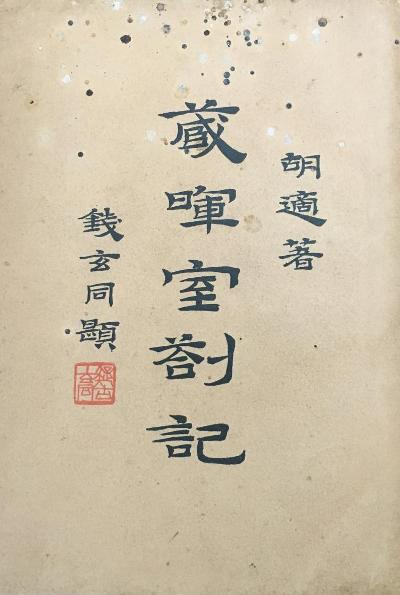
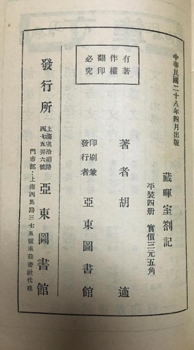
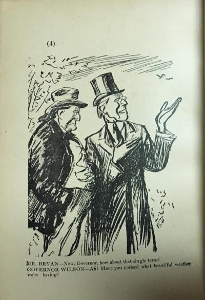
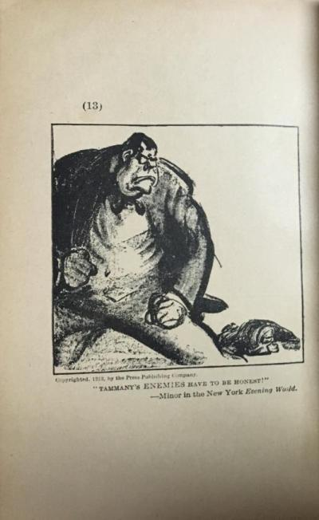
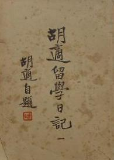
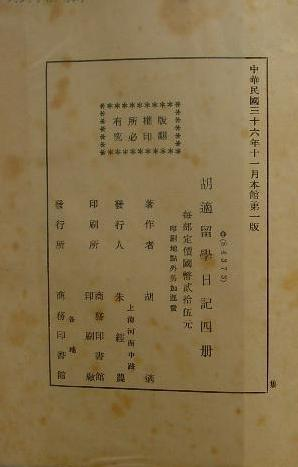

# 初版影像

> 序跋附录　序号 1 / 1006　来源: [https://www.xuges.com/xdmj/hushi/lx/000.htm](https://www.xuges.com/xdmj/hushi/lx/000.htm)

---

胡适著

藏晖室札记

钱玄同题

中华民国二十八年四月出版

平装四册实价三元五角

印刷兼发行者 亚东图书馆

胡适留学日记

胡适自题

中华民国三十六年十一月本馆第一版

胡适留学日记四册

每部定价国币贰拾伍元

印刷发行 商务印书馆
