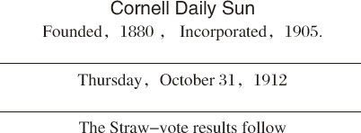
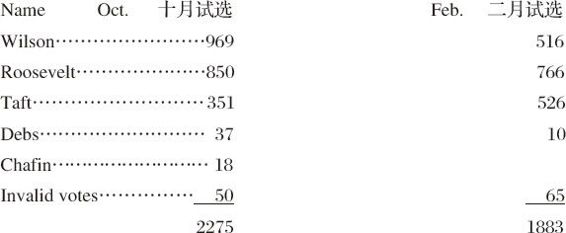
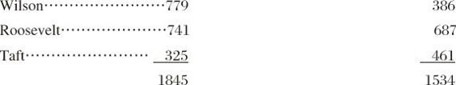
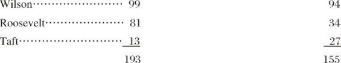
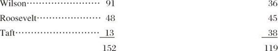
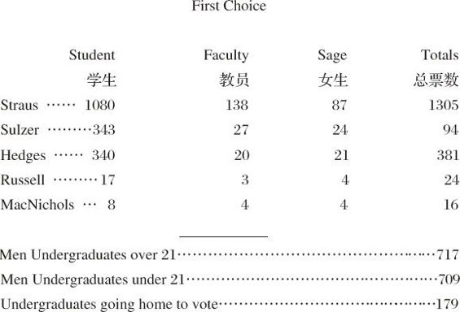

# 一九一二年十月卅一日（星四）

> 卷二（1912）　序号 315 / 1006　来源: [https://www.xuges.com/xdmj/hushi/lx/314.htm](https://www.xuges.com/xdmj/hushi/lx/314.htm)

---

上课。

昨日《大学日报》亦举行游戏选举，得票最多者为Wilson，其次为Roosevelt，二人相距百票耳。Taft则瞠乎其后，仅三百票耳。原文附粘于后。予亦往投票，所选者Roosevelt也。

TOTAL VOTE（总票数）

UNDERGRADUATE VOTE（学生票）

FACULTY VOTE（教员票）

SAGE VOTE（女生票）

BALLOT FOR GOVERNOR（纽约省长选举）

此次所选纽约省长为Oscar
Straus，乃一犹太人，然其人名重一时，人多归之。即如此间选Straus之票，多于他人几及一千，虽学生中亦多犹太人，然教员中亦多归之者。可见人心之趋向，初不拘种族界限矣。

夜读书。
