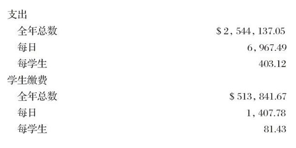
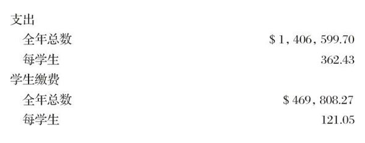
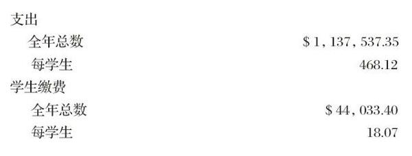

# 卷三 二五、康乃耳大学费用

> 卷三（1913–1914）　序号 387 / 1006　来源: [https://www.xuges.com/xdmj/hushi/lx/386.htm](https://www.xuges.com/xdmj/hushi/lx/386.htm)

---

（一月廿三日）

本校收支表（1912—1913）

一、全校

二、六个非省立的学院

三、省立两学院（农学院与兽医学院）

此一则见一九一三年一月八日之本校日刊。
