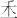

# 卷三 四七、《说文》有许多字不满人意

> 卷三（1913–1914）　序号 409 / 1006　来源: [https://www.xuges.com/xdmj/hushi/lx/408.htm](https://www.xuges.com/xdmj/hushi/lx/408.htm)

---

（二月九日）

《说文》有许多字不满人意：

大

分明是人形手足满引。以示大之义。如《说文》“天大地大”云云，乃后人附会之词，初民不能作此种哲学语也。

天

像人上之物，尊之也。

王

像土上有物，示土地之主之意。《说文》引董仲舒之说，亦书生之谈，初民不能有此种思想也。

玉

当从古文“

”，王者所佩，贵之也。许氏注玉字作十数语，多而无当，是汉人说经大病。
