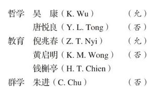

# 卷四 六、学生会之哲学教育群学委员会

> 卷四（1914）　序号 422 / 1006　来源: [https://www.xuges.com/xdmj/hushi/lx/421.htm](https://www.xuges.com/xdmj/hushi/lx/421.htm)

---

（四月一日）

学生会会长郑莱君委余为哲学教育群学部委员长，本部委员六人，今日作书予之，尚未知能尽得此诸人否？

