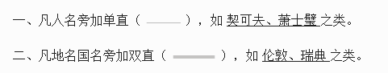
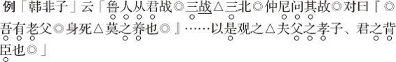
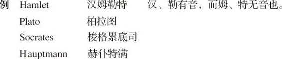

# 卷五 三一、标点符号释例

> 卷五（1914）　序号 501 / 1006　来源: [https://www.xuges.com/xdmj/hushi/lx/500.htm](https://www.xuges.com/xdmj/hushi/lx/500.htm)

---

（七月廿九日）

我所作日记札记，向无体例，拟自今以后，凡吾作文所用句读符号，须有一定体例。因作释例曰：

三、凡书名报名上下加矩（矩者，「」也），如 「放火记」，「杀狗记」。

四、凡引用他人言语，或书中语句，于所引语之前后加矩，如「老子」曰，「绝圣弃智，民利百倍」。

五、如所引语中又有引语焉，则于引语中之引语前后加双（『』）以别之，如子闻之曰，「汝奚不曰，『其为人也，发愤忘食，乐以忘忧，不知老之将至云尔。』」又「庄子」曰，『齐谐』者，志怪者也。『谐』之言曰，『鹏之徙于南冥也……』。」如引语之引语中又有引语焉，则加三矩（

）以别之，如曰，「臣闻之胡龁曰，『王坐于堂上，……王问曰，

牛何之？

对曰，

将以衅钟。

』」（四年二月，张子高以书问引语符号，似不敷用，因改正此则。）

六、句读符号。

甲、句用。「马氏文通」曰，「凡有起词语词，而辞意已全者曰句，未全者曰读。」

乙、读用△。

丙、顿用、「凡句读中字面少长，而辞意应少住者曰顿。」

例「封禅书」云「臣尝游海上△见安期生。安期生食臣枣、大如瓜。

安期生、仙者△通蓬莱中。合△则见人。不合△则隐。」

丁、加圈点之文，句用◎，读顿同上。

七、译外国音例  有音之字正写，无音而有声之字偏写。

八、注用双括弧（

），或偏半格写。
