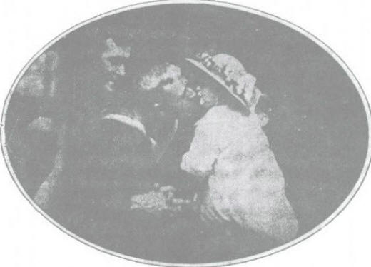

# 卷六 二一、征人临别图

> 卷六（1914）　序号 533 / 1006　来源: [https://www.xuges.com/xdmj/hushi/lx2/021.htm](https://www.xuges.com/xdmj/hushi/lx2/021.htm)

---

（八月廿五日）

英国水兵出征，自火车窗上与其女亲吻为别之图，见二十三日《纽约时报》。此图大可抵得一篇《征人别赋》。

征人临别图
