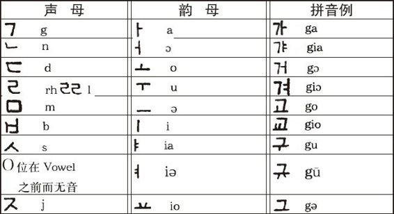
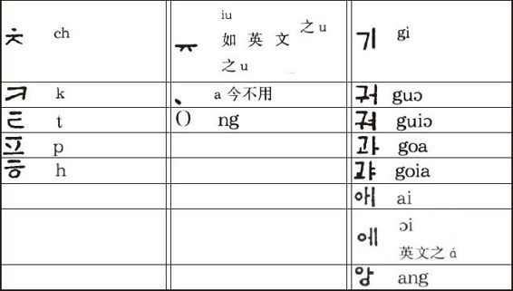
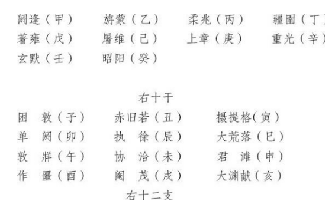

# 卷六 三二、朝鲜文字母

> 卷六（1914）　序号 543 / 1006　来源: [https://www.xuges.com/xdmj/hushi/lx2/031.htm](https://www.xuges.com/xdmj/hushi/lx2/031.htm)

---

（九月十五日）

吾友韩人金铉九君言，“朝鲜本有此种文字，其原甚古，至汉文入，此语遂衰，至五百年前始有人恢复之，今普及全国，惟中上社会犹用汉文汉语耳。”此种字母源出何语耶？吾国古代未有象形文字之先曾有字母否？如有之，尚可考求否？如无之，则仓颉以前，吾国用何种语言耶？天皇作“干支”，其名皆似一种拼音之字，彼所用是何语耶？附干支之名：

此种名如何传至后世耶？记之者何所本耶？
