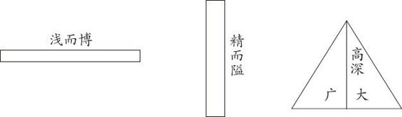

# 卷八 一五、为学要能广大又能高深

> 卷八（1914–1915）　序号 612 / 1006　来源: [https://www.xuges.com/xdmj/hushi/lx2/100.htm](https://www.xuges.com/xdmj/hushi/lx2/100.htm)

---

（二月三日）

学问之道两面（面者，算学之dimension）而已：一曰广大（博），一曰高深（精），两者须相辅而行。务精者每失之隘，务博者每失之浅，其失一也。余失之浅者也。不可不以高深矫正之。

