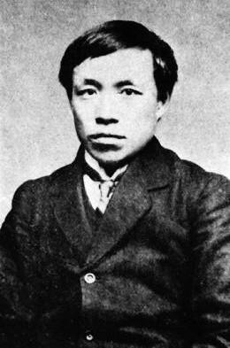

# 卷九 七、蒋翊武

> 卷九（1915）　序号 636 / 1006　来源: [https://www.xuges.com/xdmj/hushi/lx2/124.htm](https://www.xuges.com/xdmj/hushi/lx2/124.htm)

---

（二月廿二日）

又有蒋君翊武，曾肄业中国公学。革命军起，立功为军事顾问。及第二次革命失败，君亡命广西，死焉。年二十九。《民国报》载其小传，谓“善杨卓林，与创《竞业旬报》，以通俗体鼓吹民族主义，为端方摧残。卓林遇害，蒋潜归澧……”此则不甚确。蒋与杨皆竞业学会会员，而《旬报》则非其所创也。吾主《旬报》且一年，知之颇详，亦识卓林。卓林穷困，寄食旬报社中，吾时时见之，蒋则不常见也。

蒋翊武（1884—1913）

〔附记〕

《旬报》主笔前后共三人：傅君剑（钝根），张无为（丹斧），及余也。
