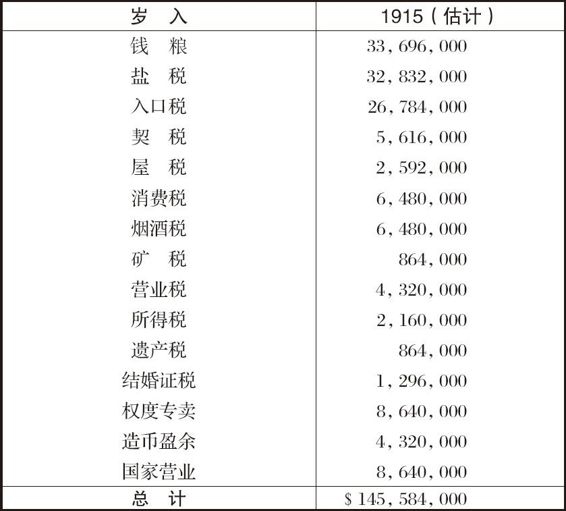
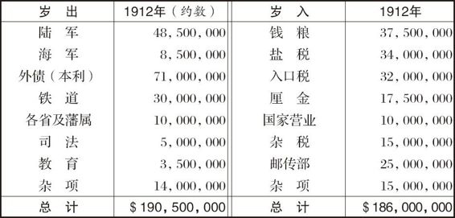

# 卷九 二五、吾国之岁出岁入

> 卷九（1915）　序号 654 / 1006　来源: [https://www.xuges.com/xdmj/hushi/lx2/142.htm](https://www.xuges.com/xdmj/hushi/lx2/142.htm)

---

（三月）

据美国上海领事General Thomas
Sammons之报告，吾国关税收入，一九一三年为32,603,646元，一九一四年减至26,612,388元。下乃吾国财政部编制之本年岁入估计：

据Whitaker所载，吾国一九一二年份之岁出岁入如下（参看本卷第一三则）：

