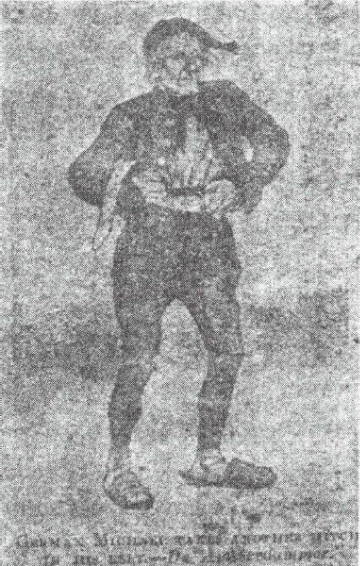
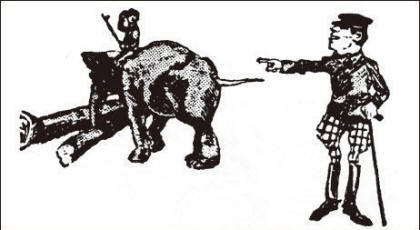
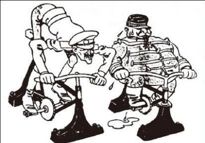
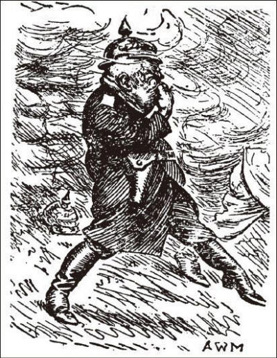
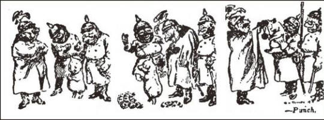
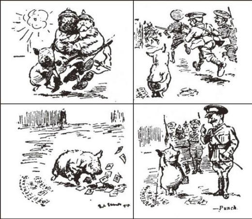
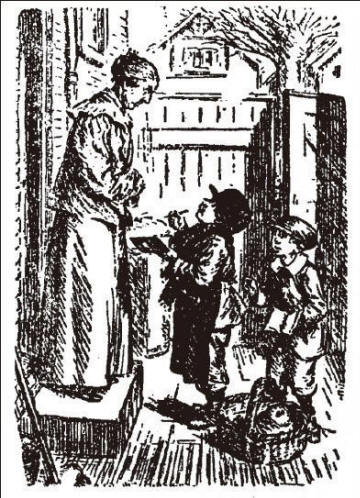
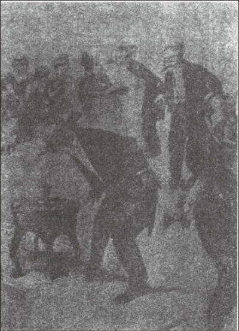

# 卷十 一一、题欧战讽刺画

> 卷十（1915）　序号 718 / 1006　来源: [https://www.xuges.com/xdmj/hushi/lx3/011.htm](https://www.xuges.com/xdmj/hushi/lx3/011.htm)

---

（七月十一日）

自战祸之兴，各国报章之讽刺画多以此为题，其中殊多佳品，偶择其尤，附载于此：

既载此八画，戏为作题词，以三十分时成七则，亦殊有隽妙之语，颇自憙也。四七两章大有古乐府风味。

一

为计三年蓄，朝朝减带围。但听新报捷，真可以忘饥。

Copyright byG. Hirth's Vcrlag

By way of comment on Hagenbeck's gift of an elephant to the German army
transport service, John Buil is imagined by "Jugend" as saying, "It's not fair,
my subjects must not fight for Germany".

二

身毒大象，帝国臣隶，敬告吾仇，防其反噬。

此一则反复不能成章，其他七则既成，余往就餐，食时得此。

A BERLIN（as berlin sees it）

Copyright byVerlag der Lustingen B'utrse

Grand duke nicholas of Russla and gienral joffre.

each mounted on a handy home exercisrr- "We are going forward" — "Lustige
Blatter".

三

十月同舟谊，强仇患正深。车轮生四角，何时到柏林？

AN ILL WIND

German (As wind changes) — “Gott Strafe England.” —Punch

四

狂风吹我，我则唾汝！丑而英伦，上帝祸汝！

THE REWARD OF KULTUR

五

教化及于禽兽兮，豕人立而布辞。

惟英伦之跋扈兮，祝上帝其殛之。

FURTHER ADVENTURES OF THE CULTURED PIG

六

一字褒贬，可以全躯。

春秋之笔欤？淳于之徒欤？

THE SHORTAGE OF MEN

"Now then! What do you little boys want?"

"'E's ver baker, N' I'm ver butcher.

An' we've come for orders."

—Punch.

七

八岁卖肉，七岁卖面；父兄何在？为国苦战。

RANGE FINDING

"Now then! What do you little boys want?"

"'E's ver baker, 'N'I'm ver butcher.

An'we've come for orders."

—Punch.

八

跳舞筵前，迷藏灯下，念之念之，何以对逝者！
