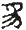

# 卷十一 一四、如何可使吾国文言易于教授

> 卷十一（1915）　序号 750 / 1006　来源: [https://www.xuges.com/xdmj/hushi/lx3/043.htm](https://www.xuges.com/xdmj/hushi/lx3/043.htm)

---

（八月廿六夜）

作一文（英文）论“如何可使吾国文言易于教授”，将乞赵君元任于今年东美学生年会时读之。

先是有钟某等广刊传单，极力诋毁汉文，主张采用字母，以为欲求教育之普及，非有字母不可。……其词极激昂，志在动人也。余以为此问题至重大，不当以意气从事，当从容细心研究之，故建议以“国文”为今年年会讨论问题。而分此题为二分：先论国文，次论国语，吾与赵君分任之。赵君作论，论吾国语能否采用字母制及其进行方法。吾则择上所记题。

吾文大旨如下：

一、无论吾国语能否变为字母之语，当此字母制未成之先，今之文言，终不可废置，以其为仅有之各省交通之媒介物也，以其为仅有之教育授受之具也。

二、汉文问题之中心，在于“汉文究可为传授教育之利器否”一问题。

三、汉文所以不易普及者，其故不在汉文，而在教之之术之不完。同一文字也，甲以讲书之故而通文，能读书作文；乙以徒事诵读，不求讲解之故，而终身不能读书作文。可知受病之源，在于教法。

四、旧法之弊，盖有四端：

（一）汉文乃是半死之文字，不当以教活文字之法教之。（活文字者，日用语言之文字，如英法文是也，如吾国之白话是也。死文字者，如希腊、拉丁，非日用之语言，已陈死矣。半死文字者，以其中尚有日用之分子在也。如犬字是已死之字，狗字是活字；乘马是死语，骑马是活语。故曰半死文字也。）

旧法不明此义，以为徒事朗诵，可得字义，此其受病之根源也。教死文字之法，与教外国文字略相似，须用翻译之法，译死语为活语，所谓“讲书”者是也。

（二）汉文乃是视官的文字，非听官的文字。凡象形会意之文字，乃视官的文字；而字母谐声之文字，皆听官的文字也。

凡一字有二要；一为其声，一为其义。无论何种文字，不能同时并达此二者。字母的文字，但能传声，不能达意；象形会意之文字，但可达意，而不能传声。

例  英文dog（狗），合三字母而成。能拼音者，皆知其音为“多葛”。然何以此dog三字母合成则为狗？此则无从索解，但须强记而已。

至汉文之“犬”则不然。“

”乃象形之字，义即在形中，无待远求。惟犬何以读如犬，则亦无从索解，但须强记而已。

更取稍繁复之字以明之：

英文candidate（候选人），拉丁文为candidatus（候选人），本义为“白衣人”，以罗马制，凡选人皆衣白故也。源出candidus（色白），更出动词candēre（发白，作白色），与梵文chand（照耀）盖有关系。自英文之字溯源至于梵文，可谓深矣。而终不能知何以candēre为“作白色”，与夫何以chand有“照耀”之义，终须强记耳。

至于汉文则不然。如“猫”字，析之得

二字。

以示此物属肉食兽类，

以示此兽鸣声。合之为“作苗声之肉食兽”也。“苗”字象田上所植草。更析之，则“艸”象形，“田”指事也。皆足达意而不能传声。学者须强记艸读为艸，田读为田，苗读为苗也。

是故，切韵之语与会意之语，各有所长，亦各有所短。

今之汉文，已失象形、会意、指事之特长，而教者又不复知说文学。六书`之学，向之以授八岁之孩童者，今虽老生宿儒未必知之。其结果遂令吾国文字既不能传声，又不能达意。向之有一短者，今并失所长。学者不独须强记字音，又须强记字义，是事倍而功半也。

欲救此弊，须用何法乎？

（1）将恢复篆书耶？此必不可得之事也。

（2）当鼓励说文学（字源学）。

（3）当以古体与今体同列教科书中。

（4）小学教册中之新字须遵六书之法，先令童蒙习象形指事之字，徐及浅易之会意字，次及浅易之形声字。其字源不易明解者，宜俟之稍进之学级，不当以发蒙也。

商务印书馆之初级教科书第一页有“天地日月山川草木”八字。夫“草”字为艸之俗字，不当以之教人。其“天”“地”二字之字源极不易解，非童蒙所能晓也。（

源出一

，

象人形〔初民以肢体量物，手足所极，故为大也〕。人上之物，故曰天也。

从土。

即也字，本义为女阴也。初民迷信，以地配天。地乃土上雌性之一物，所以配天者也。）

（5）中学以上，皆当习字源学。

凡此诸法，皆所以增益儿童识字之兴趣。令其由兴趣记忆字义，则其记忆也，不劳而易能，庶几稍复吾国文字既失之一长云尔。

（三）吾国文本有文法，而古来从未以文法教授国文。今《马氏文通》出世已近廿载，而文法之学不治如故。夫文法乃教文字语言之捷径。今当提倡文法学，使普及国中；又当列“文法”为必须之学科，自小学至于大学，皆当治之。

（四）吾国向不用文字符号，致文字不易普及；而文法之不讲，亦未始不由于此（说见所著《文字符号论》）。今当力求采用一种规定之符号，以求文法之明显易解，及意义之确定不易。

此文盖三日夜始成。
