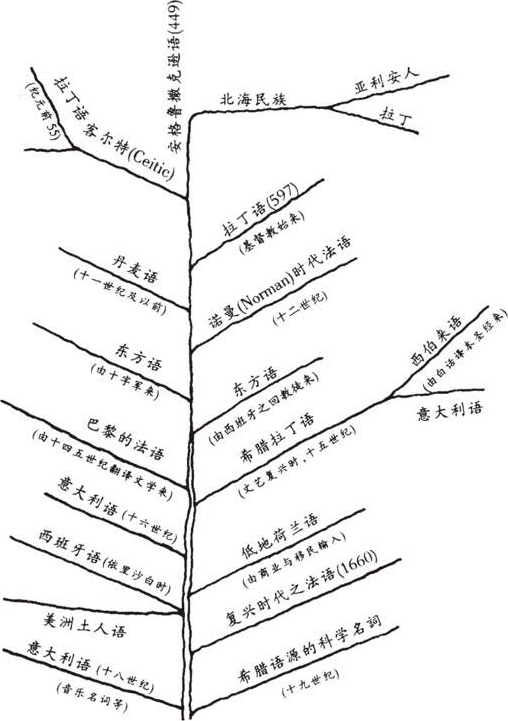

# 卷十一 一七、成诗不易

> 卷十一（1915）　序号 753 / 1006　来源: [https://www.xuges.com/xdmj/hushi/lx3/046.htm](https://www.xuges.com/xdmj/hushi/lx3/046.htm)

---

（八月廿七日）

吾应作诗追挽亡友张希古（美品）、郑仲诚（璋）及白特生夫人，而终不能成文。又思作诗留别绮色佳朋友山水，亦不能成文。他日终当为之耳。

英文渊源图
