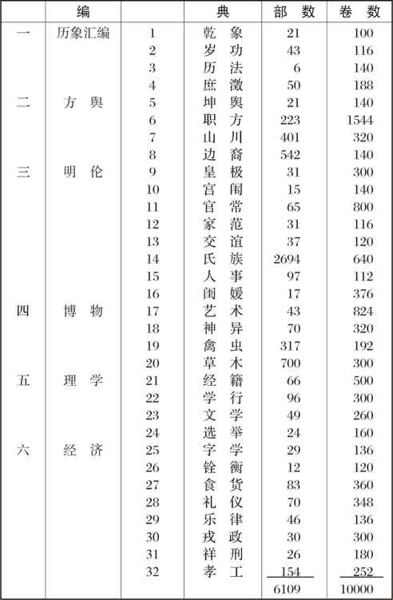

# 卷十一 三八、《古今图书集成》

> 卷十一（1915）　序号 774 / 1006　来源: [https://www.xuges.com/xdmj/hushi/lx3/067.htm](https://www.xuges.com/xdmj/hushi/lx3/067.htm)

---

（十月一日）

哥伦比亚大学有中国政府所赠之雍正三年刊竣之《古今图书集成》一部（有雍正四年九月廿七日上谕）。此世界一大书也。原订五千册，今合为巨册，成一千六百七十二册。共一万卷，合为六千一百零九部，总为三十二典，汇为六编。（见下表）

据此间汉文教授夏德先生（Friederich
Hirth）告我：“此非雍正年原板，乃总理衙门所仿印也。据端午桥之言如此。”夏德先生又言：“雍正初板并不如后日上海图书集成书局所出活板之精。以原板铜字不完，或有所阙，则假借他字以代之。而上海之板校对极精故也。”

满清康熙、雍正、乾隆三帝，鼓励文学，搜集文献，刊刻类书巨制，其功在天地，不可泯没也。
