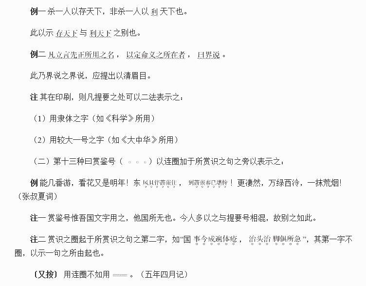

# 卷十一 四一、文字符号杂记二则

> 卷十一（1915）　序号 777 / 1006　来源: [https://www.xuges.com/xdmj/hushi/lx3/070.htm](https://www.xuges.com/xdmj/hushi/lx3/070.htm)

---

（十月十五日）

（一）第十二种曰提要号（~~~~~~~）以浪线加于字或句之旁，以示文中着意注重之处：

