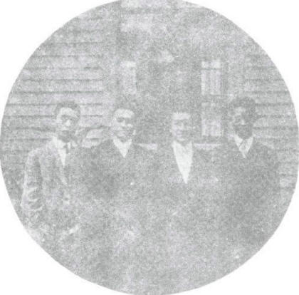

# 卷十二 八、梅、任、杨、胡合影

> 卷十二（1915–1916）　序号 796 / 1006　来源: [https://www.xuges.com/xdmj/hushi/lx3/089.htm](https://www.xuges.com/xdmj/hushi/lx3/089.htm)

---

（一月五日）

将去绮色佳时，杏佛以其摄影器为造此图。昨承其以一份见寄，为附此而记之。

梅、任、杨、胡合影
