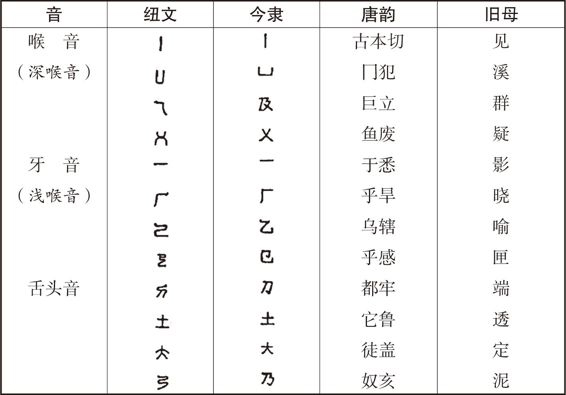
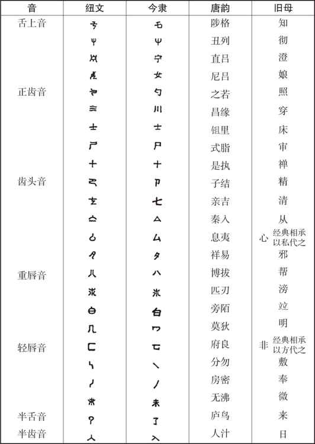
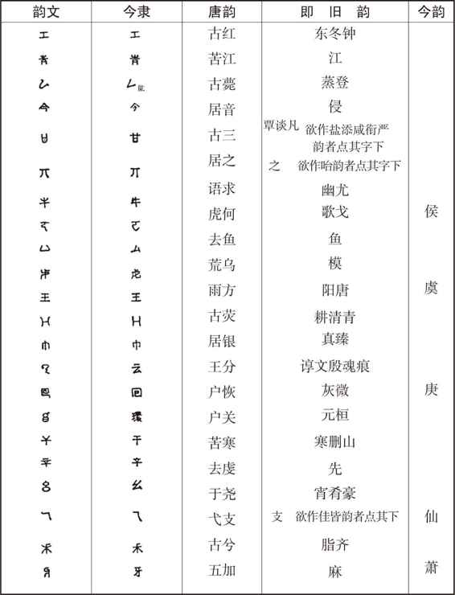

# 卷十二 一二、读章太炎《驳中国用万国新语说》后

> 卷十二（1915–1916）　序号 800 / 1006　来源: [https://www.xuges.com/xdmj/hushi/lx3/093.htm](https://www.xuges.com/xdmj/hushi/lx3/093.htm)

---

（一月廿四夜）

读此篇竟，记其重要之处如下：

若夫象形合音之别，优劣所在，未可质言。今者南至马来，北抵蒙古，文字亦悉以合音成体，彼其文化岂有优于中国哉？合音之字视而可识者，徒识其音，固不能知其义，其去象形差不容以一黍。故俄人识字者，其比例犹视中国为少。日本既识“假名”，亦并粗知汉字。汉字象形，日本人识之不以为奇怪难了，是知国人能遍知文字与否，在强迫教育之有无，不在象形合音之别也。……

然言语文字者所以为别，声繁则易别而为优，声简则难别而为劣。……

纵分“音纽”，自梵土“悉昙”而外，纽之繁富未有过于汉土者也。横分“音韵”，梵韵复不若汉韵繁矣。……昔自汉末三国之间始有反语。隋之切韵，以纽定声。舍利、神珙诸子综合其音，参取梵文字母声势诸法分列八音。至今承用者，为字母三十六，而声势复在其外，以现有法言切韵也。今之韵部，著于唇音者，虑不能如旧韵之分明，然大较犹得二十。计纽及韵可得五十余字，其视万国新语之以二十八字母含孕诸声者，繁简相去，至悬远也。……字母三十六者，本由“华岩”四十二字增损而成。……以此三十六者按等区分，其音且逾数百。韵以四声为剂，亦有八十余音。二者并兼，则音母几将二百。然皆坚完独立，非如日本五十“假名”，删之不过二十音也。宁有二十八字之体文遂足以穷其变乎？……

〔适按〕太炎先生此论，可谓无的放矢矣。万国新语之长处，正在其声简易通。且其语不废尾纽，（纽有首尾之别。如英语sat，s为首纽，t为尾纽，a为韵也。汉字尾纽今皆亡矣，独鼻音N
ng二尾纽犹存耳。广东之入声尾纽犹多存者。其合口之鼻音M，则平上去三声皆有之。故其辨“真”“侵”“覃”“寒”若辨黑白也。）故虽二十八字而已足用。如“三”之与“山”，若尾纽全存时，则同一首纽而音犹可辨（如粤音之以三为sam，以山为san是也）。今尾纽既仅存一半开之鼻音，则二字非有异纽为首不能辨矣（京津人辨此二字惟在首纽）。汉语纽音之繁，未必即其长处，特不得不繁耳。

虽然，辅汉文之深密，使易能易知者则有术矣。

（一）欲使速于疏写，则人人当兼知章草。……文字宜分三品：题署碑版，则用小篆；雕刻册籍，则用今隶；至于仓卒应急，取备事情，则直作草书可也。

（二）若欲易于察识，则当略知小篆，稍见本原。初识字时，宜教以五百四十部首。……凡儿童初引笔为书，今隶方整，当体则难。小篆诎曲，成书反易。且“日”“月”“山”“水”诸文，宛转悉如其象，非若隶书之局就准绳，与形相失。当其知识初开，一见字形，乃如画成其物，踊跃欢喜，等于熙游，其引导则易矣。

〔适按〕此说与吾前作《文字教授法改良论》中所持说不期而合。

象形之与合音，前者易知其义，难知其音；后者易知其音，难知其义。……故象形与合音者，得失为相庚。特隶书省变之文，部首已多淆乱，故五百四十小篆为初教识字之门矣。

〔适按〕此说尤与吾所持论若合符节。吾所为文（英文，在中城学生年会所读）原文曰：

Every word, be it Chinese or European, has two elements: its sound and its
meaning. An alphabetical language, like the English, gives you the sound or
pronunciation of the word. But you must get the meaning by sheer memory
work….But when you look at the Chinese characters in their original forms, you
immediately perceive their pictorial likenesses. But there is nothing in these
picture which suggest that they are pronounced as they are pronounced….

〔中译〕

每一字，不论其是中文，还是欧洲文字，皆有两个要素：音与义。合音之文字，如英文，易知其发音或声音。然而，汝若要知其义，则纯靠记忆之功夫……但是中国文字，一见其颇有独创性之字形，汝便可立即悟出其象形之义。可是，此象形却不能指示其发音，易知其义，难知其音……

（三）若欲了解定音，反语既著，音自可知。然世人不能以反语得音者，以用为反语之字非有素定。尚不能知反语之定音，何由知反语所切者之定音哉？若专用“见”“溪”以下三十六字，“东”“钟”以下二百六十字为反语，但得二百四十二字之音，则余音自可睹矣。然此可为成人长者言之，以教儿童，犹苦繁冗。……

尝定“纽文”为三十六，“韵文”为二十二，皆取古文篆籀径省之形以代旧谱。……

纽文三十六

韵文二十二

〔适按〕太炎先生所拟字母，其笔画则较旧表为简矣，然而有大疵二，小疵二：

（一）韵文惟

字是半无纽之韵，其余皆有首纽。有首纽，则反音之时作箭之纽（反切之上一字为箭，下为标）。与作标之韵之纽相复。此旧谱之病，而太炎先生因之。

（二）韵文二十二字不敷用也。例如，

字一母，而以反八韵之字，其必至纷乱可想。此大疵二也。

（一）纽文中用有尾纽之字。有尾纽，则与作标之韵相混，而得音不易。旧谱之“穿”，今谱之“川”，皆其例也。

（二）谱中之篆文“

”“

”及今隶“

”“

”，形似相混。此小疵二也。

顷又见纽文之

（乎旱切）与

（乎感切），既同用“乎”字作箭，则其为同纽可知。今乃用为二纽，可谓粗心矣。

总之，此谱之韵文全不可用，纽文亦有疵瑕。太炎之长在于辨纽，其短在于辨音太疏也。
