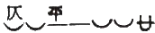
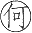
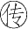

# 卷十二 一四、七绝之平仄

> 卷十二（1915–1916）　序号 802 / 1006　来源: [https://www.xuges.com/xdmj/hushi/lx3/095.htm](https://www.xuges.com/xdmj/hushi/lx3/095.htm)

---

（一月廿六日）

凡七言绝句之

之句，第三字皆当用平声。必不得已而用仄，则第五字当用平。例如：

笑问

从

处来

忽见

头

柳色

日暮

宫

蜡烛

又凡七言绝句，每句之第三字皆以平声为佳；无论其为

或为

也。试检《唐诗三百首》中之七绝五十余首，共二百余句，其第三字用仄者不过二十余句。如：

梨花

地不开门（第六字平，故第五字不妨仄也。）

葡萄

酒夜光杯

此二十余句之中，十之八皆

之句也。
