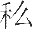

# 卷十二 一九、读音统一会公制字母

> 卷十二（1915–1916）　序号 807 / 1006　来源: [https://www.xuges.com/xdmj/hushi/lx3/100.htm](https://www.xuges.com/xdmj/hushi/lx3/100.htm)

---

（一月卅一日）

〔原注〕

作母用，取其双声。作韵用，取其叠韵。（用古双声叠韵）

母音二十四

ㄍ古外切，今读若“格”，发声务短促下同。

ㄫ五忽切，今读若“我”。

ㄑ苦泫切，古“畎”字，今读若“欺”。

ㄉ都劳切，今读若“德”。

ㄋ奴亥切，古“乃”字，今读若“纳”。

攵普木切，小击也，今读若“泼”。

ㄈ府良切，今读若“弗”。

ㄎ苦诰切，今读若“克”。

ㄐ居尤切，延蔓也，今读若“基”。

ㄬ疑检切，读“醃”上声，今读若“腻”。

ㄊ他骨切，同“突”，今读“脱”。

ㄅ同“包”，今读若“拨”。

ㄇ莫狄切，今读若“墨”。

ㄪ同“万”，今读若“物”。

ㄗ古“节”字，今读若“子”。

ㄙ古“

”字，今读“私”。

ㄔ丑亦切，今读若“痴”。

ㄏ呼旰切，今读若“黑”。

ㄌ同“力”，今读若“勒”。

ㄘ亲吉切，今读若“此”。

ㄓ真而切，今读若“之”。

ㄕ式之切，今读若“尸”。

ㄒ古“下”字，今读“希”。

ㄖ今读若“入”。

介音三

—于悉切，今读若“衣”。

ㄨ疑古切，古“五”字，今读若“乌”。

ㄩ丘鱼切，饭器也，今读若“迂”。

韵十二

ㄚ于加切，今读若“阿”。

ㄟ余支切，流也，今读若“危”。

ㄡ于救切，今读若“呕”。

ㄣ古文“隐”字，今读若“恩”。

ㄛ“阿”本字，今读若“痾”。

ㄞ古“亥”字，今读若“爱”。

ㄝ羊者切，语已辞，今读“也”。

ㄠ于尧切，小也，今读若“豪”。

ㄢ乎感切，嘾也，今读若“安”。

ㄥ古“肱”字，今读若“哼”。乌光切，跛曲径也，今读若“昂”。

ㄦ而邻切，今读若“儿”。
