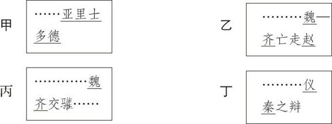
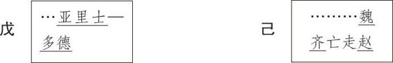

# 卷十三 四、论文字符号杂记四则

> 卷十三（1916）　序号 841 / 1006　来源: [https://www.xuges.com/xdmj/hushi/lx3/134.htm](https://www.xuges.com/xdmj/hushi/lx3/134.htm)

---

（四月廿三夜）

一、闽清林和民君（有任）读余《文字符号论》（《科学》二年一号），移书谓“吾国无间接引语”。此亦不然。今试举数例：

（一）孔子曰：……丘也闻“有国有家者，不患寡，而患不均”。

（二）曾子曰：吾闻诸夫子：“人未有自致者也，必也亲丧乎？”

（三）子夏曰：商闻之矣：“死生有命，富贵在天。……”

（四）此谓“身不修，不可以齐其家”。

以上在引号内之诸语，皆间接引语也。

二、林君又言吾所用线号（例如胡适）有不便处。如书写时，或排印时，一行已尽，而一名未完，势不得不分作两行，如：

不知者，或误以（甲）例亚里士多德为二名，而（丁）例仪秦为一名。此言甚是。吾意此后当于一名截断分行之处加一短线，以示其为一名。如下例：

以（己）与（丙）比较而观，则其相异之处可见矣。

三、吾前作赏鉴号，采用旧时连圈之法，至今思之，似不甚妥。连圈有二病：

（一）易与断句之圈相混；

（二）甚费力。

今拟以下诸说，而未能自决也。

（一）废赏鉴号而不用。

（二）或与提要号（~~~~~~）同用一种符号。

（三）或用双线法（=======）。例如：

……去年春恨却来时，落花人独立，微雨燕双飞。

四、上所记“间接引语”，意有未尽，更记之。

例一  儿童相见不相识，笑问“客从何处来？”

例二  下马饮君酒，问“君何所之？”

此皆直接引语也。所用“客”字、“君”字，皆对称代名（Second Person Pronoun，用日本人译名）也。

例三  儿女……怡然敬父执，问我来何方。

此间接称引也。所用“我”字是自称代名（First Person Pronoun）。若改“我”为“客”，则直接引语矣。

例四  林君寄余书曰：“君所作‘文字符号论’有不妥处。”

此直接引语也。今易为间接：

例五  林君寄余书，谓余所作“文字符号论”有不妥处。

此亦易对称代名为自称代名也。
