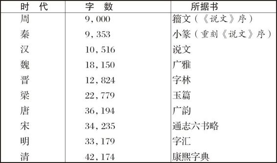
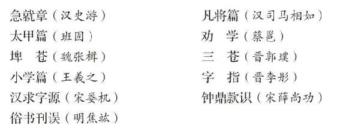
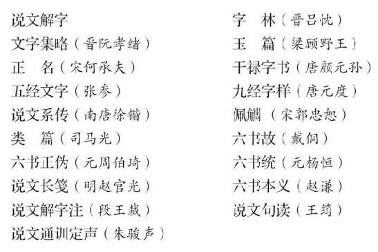
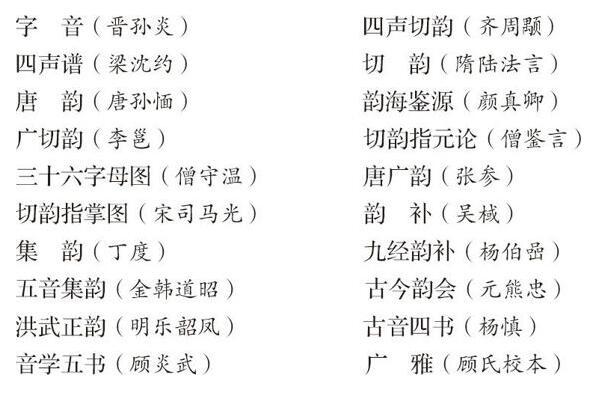
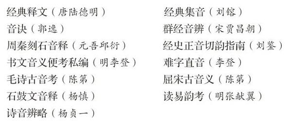
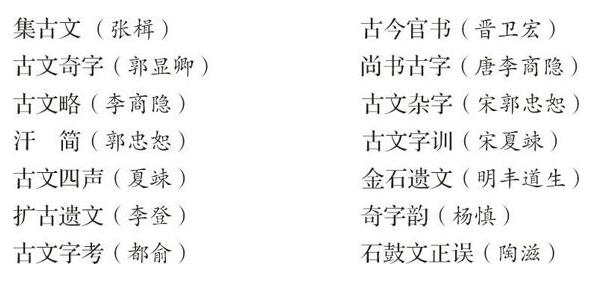
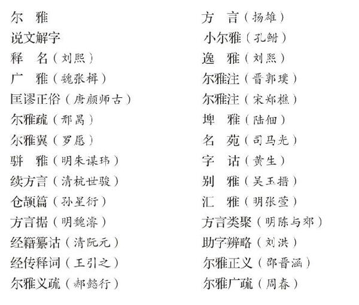

# 卷十三 六、读萧山来裕恂之《汉文典》

> 卷十三（1916）　序号 843 / 1006　来源: [https://www.xuges.com/xdmj/hushi/lx3/136.htm](https://www.xuges.com/xdmj/hushi/lx3/136.htm)

---

（四月廿九日）

此书眼光甚狭，殊不足取。记其足供调査者数事：

文字学古书

（一）体制

甲、小学

乙、文字

（二）音韵

甲、音韵

乙、音释

（三）训诂

甲、古文

乙、训诂

