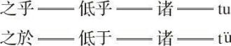

# 卷十三 一〇、记“的”字之来源：“之者”二字之古音

> 卷十三（1916）　序号 847 / 1006　来源: [https://www.xuges.com/xdmj/hushi/lx3/140.htm](https://www.xuges.com/xdmj/hushi/lx3/140.htm)

---

（五月廿五日）

吾尝研究“的”字之文法（《季报》三年三号），知此字今用以代文言之“之”字、“者”字（此外用法尚多）。凡“之”字、“者”字之种种用法，多可以“的”字代之。因念此诸字变化沿革，或由于声韵的变迁，倘能求其历史的关系，则今之俗字，或竟为最古之字亦未可知。而吾人所谓俗者，不过一种无根据之恶感，蔽于积俗，而不知其非耳。（《月报》十一卷八号）

此诸字之关系沿革，大略如下：

赵宣仲曰：“‘之’字古盖读如今‘的’字。凡知、彻、澄三纽之字，原为舌上的端、透、定（Cerebral tt' &
d）。其后此一类之音，变为照、穿、床（正齿），于是重复兴焉。”

宣仲之言是也。“者”字之沿革略同此。“者”字古盖读如“堵”，后始变而为“煮”，后乃转为“者”耳。秦始皇《琅玡台刻石》曰：

六合之内，皇帝之土：

西涉流沙，南尽北户；

东有东海，北过大夏。（索隐音户）

人迹所至，无不臣“者”。（音堵）

功盖五帝，泽及牛马。（音姥）

莫不受德，各安其宇。

又《诗·采绿》：

其钓维何？维鲂及鱮。

维鲂及鱮，薄言观“者”。（《韩诗》作覩）

又《楚辞·九歌》：

搴汀州之杜若，

将以遗乎远“者”。（朱注：者叶音渚，又音覩）

时不可兮骤得，

聊逍遥兮容与。

皆可证古“者”之读“堵”也。观合“者”以成声之字，如都，阇，堵，覩，睹，屠诸字，又可见“者”字本端、透、定纽也。

“之”字古音为“的”（或低），亦可于“诸”字见之。“诸”字乃“之乎”二字或“之於”二字快读合成之音。“诸”字古盖音“都”（例同上），其切音之式为之乎为

当文言之“者”变为“止野切”之后，口语之“者”犹作“堵”声，后变而为“朵”声。缪袭“挽歌”云：

形容稍消歇，齿发行当堕。

自古皆有然，谁能离此“者”？

晋时“的”字在江左犹作“堵”声。《晋书·王衍传》曰：

衍口未尝言钱字。妇令婢以钱绕床下，不得行。衍晨起，呼婢曰：“举却‘阿堵’中物！”

“阿堵”犹今言“这个”也（《康熙字典》）。后“阿堵”变成“兀的”。“兀的”北音与“阿堵”相近。而“堵”变为“的”之沿革可见也。

宋时“的”字尚读上声，为“底”。如罗仲素曰：

天下无不是“底”父母。

古只有“底”字。底止之底，亦音底。其指音乃后来之变音也。

“之”字作动字用者，古亦音低。如“宋牼将之楚”“若魂则无不之也”是也。亦作底，如《诗》“靡所底止”，今人言“抵某处”，即此字也。

“之”字作介字用者同此。如《诗》“之死矢靡他”与《汉书·礼乐志》“抵冬降霜”同一来原。今人言“抵死不肯招”是也。
