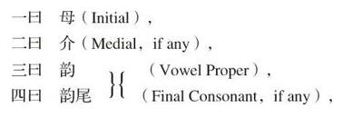
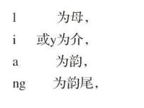

# 卷十三 一一、元任论音与反切

> 卷十三（1916）　序号 848 / 1006　来源: [https://www.xuges.com/xdmj/hushi/lx3/141.htm](https://www.xuges.com/xdmj/hushi/lx3/141.htm)

---

（五月廿五日）

赵宣仲言，中文之音凡有五部分：

宣仲不为韵尾立名，统名之曰韵，余为造此名，省曰尾。

五曰  声（The tone of the vowel），

如“梁”字（Liang）：

其声为下平也。

宣仲谓反切法之大病，在于不能为精密的解剖。如：

选  斯远切（Süen）

藓  斯掩切（Sien）

两音之异在于音介之不同：一为ü，一为i（或为y）也。其他四事：母同（s），韵同（e），尾同（n），声同（上）。

此种分析，非有字母，不能为功也。
