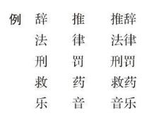

# 卷十三 二三、白话文言之优劣比较

> 卷十三（1916）　序号 860 / 1006　来源: [https://www.xuges.com/xdmj/hushi/lx3/153.htm](https://www.xuges.com/xdmj/hushi/lx3/153.htm)

---

（七月六日追记）

在绮色佳时与叔永、杏佛、擘黄（唐钺字）三君谈文学改良之法，余力主张以白话作文作诗作戏曲小说。余说之大略如下：

（一）今日之文言乃是一种半死的文字，因不能使人听得懂之故。

（二）今日之白话是一种活的语言。

（三）白话并不鄙俗，俗儒乃谓之俗耳。

（四）白话不但不鄙俗，而且甚优美适用。凡言语要以达意为主，其不能达意者，则为不美。如

赵老头回过身来，爬在街上，扑通扑通的磕了三个头。

若译作文言，更有何趣味？又如“嫖”字，岂非好字？何必故意转许多弯子而说“狎妓”、“宿娼”、“纵情青楼”。今如对众言“嫖”，无不懂者。若言“狎妓”，则懂者百之一二耳。如此而有舍“嫖”而择“狎妓”者，以为“嫖”乃俗字，而“狎妓”为典雅也，岂非顽固之尤哉？（又如“懂”字，亦一例也。）

（五）凡文言之所长，白话皆有之。而白话之所长，则文言未必能及之。（详下文〔六〕（4））

（六）白话并非文言之退化，乃是文言之进化。其进化之迹，略如下述：

（1）从单音的进而为复音的。

（2）从不自然的文法进而为自然的文法。

例  吾未之见。我没有看见他。己所不欲。自己不要的。

（3）文法由繁趋简。

例  天所杀——所

杀人者——者

天之杀人——之

此三字皆可以“的”字代之。

（4）文言之所无，白话皆有以补充。

甲、表词的形容词：

这书是我的儿子的。

这计策是消极的，而非积极的。

文言以“者也”表之，然实不合文法。

乙、副词的长顿：

他又在那里鬼鬼祟祟的干他的勾当了，

他把这事一五一十的告诉了我。

此例甚多，不可枚举。

（七）白话可产生第一流文学。

（1）白话的诗词。

（2）白话的语录。

（3）白话的小说。

（4）白话的戏剧。

此四者皆有史事可证。

（八）白话的文学为中国千年来仅有之文学（小说，戏曲，尤足比世界第一流文学）。其非白话的文学，如古文，如八股，如札记小说，皆不足与于第一流文学之列。

（九）文言的文字可读而听不懂；白话的文字既可读，又听得懂。凡演说，讲学，笔记，文言决不能应用。今日所需，乃是一种可读，可听，可歌，可讲，可记的言语。要读书不须口译，演说不须笔译；要施诸讲坛舞台而皆可，诵之村妪妇孺而皆懂。不如此者，非活的言语也，决不能成为吾国之国语也，决不能产生第一流的文学也。

此一席话亦未尝无效果。叔永后告我，谓将以白话作科学社年会演说稿。叔永乃留学界中第一古文家，今亦决然作此实地试验，可喜也。

余于二十四日自绮往克利弗兰城（Cleveland，O.）。后数日，得杏佛寄一白话诗，喜而录之：

寄胡明复

（白话）

自从老胡去，这城天气凉。新屋有风阁，清福过帝王。

境闲心不闲，手忙脚更忙。为我告“夫子”（赵元任也），

《科学》要文章。

此诗胜南社所刻之名士诗多多矣。赵元任见此诗，亦和作一首：

自从老胡来，此地暖如汤。《科学》稿已去，“夫子”不敢当。

才完就要做，忙似阎罗王。（原注“Work like h——”）

幸有“辟克匿”（Picnic），那时波士顿肯白里奇的社友还可大大的乐一场。

此等诗亦文学史上一种实地试验也，游戏云乎哉？
