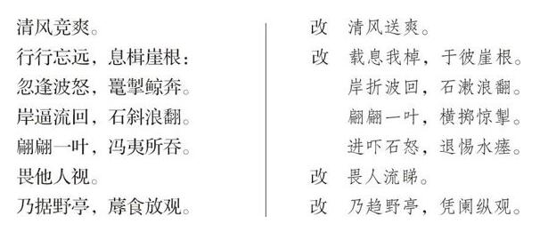

# 卷十四 二、答觐庄白话诗之起因

> 卷十四（1916）　序号 873 / 1006　来源: [https://www.xuges.com/xdmj/hushi/lx3/166.htm](https://www.xuges.com/xdmj/hushi/lx3/166.htm)

---

（七月二十九日）

此诗之由来，起于叔永《泛湖》一诗。今将此诗及其所发生之函件附录于后：

（一）叔永《泛湖即事诗》原稿

荡荡平湖，漪漪绿波。言櫂轻楫，以涤烦疴。

既备我餱，既偕我友。容与中流，山光前后。

俯瞩清涟，仰瞻飞艘。桥出荫榆，亭过带柳。

清风竟爽，微云蔽喧。猜谜赌胜，载笑载言。

行行忘远，息揖崖根。忽逢波怒，鼍掣鲸奔。

岸逼流回，石斜浪翻。翩翩一叶，冯夷所吞。

舟则可弃，水则可揭。湿我裳衣，畏他人视。

湿衣未千，雨来倾盆。濛濛远山，漠漠近澜。

乃据野亭，蓐食放观。“此景岂常？君当加餐。”

日斜雨霁，湖光静和。晞巾归舟，荡漾委蛇。

（二）胡适寄叔永书（七月十二日）

……惟中间写覆舟一段，未免小题大做。读者方疑为巨洋大海，否则亦当是鄱阳洞庭。乃忽紧接“水则可揭”一句，岂不令人失望乎？……“岸逼流回，石斜浪翻”，岂非好句？可惜为几句大话所误。……

（三）叔永答胡适（七月十四日）

……足下谓写舟覆数句“未免小题大做”，或然。唯仆布局之初，实欲用力写此一段，以为全诗中坚。……或者用力太过，遂流于“大话”。今拟改“鼍掣鲸奔”为“万螭齐奔”，“冯夷”为“惊涛”，以避海洋之意。尊意以为何如？

（四）胡适答叔永（七月十六日）

……“泛湖”诗中写翻船一段，所用字句，皆前人用以写江海大风浪之套语。足下避自己铸词之难，而趋借用陈言套语之易，故全段一无精彩。足下自谓“用力太过”，实则全未用气力。趋易避难，非不用气力而何？……再者，诗中所用“言”字、“载”字，皆系死字，又如“猜谜赌胜，载笑载言”二句，上句为二十世纪之活字，下句为三千年前之死句，殊不相称也。……以上所云诸病，我自己亦不能免，乃敢责人无已时，岂不可嗤？然眼高手低，乃批评家之通病。受评者取其眼高，勿管其手低可也。一笑。……

（五）叔永答胡适（七月十七日）

顷读来书，极喜足下能攻吾之短。今再以“泛湖”诗奉呈审正。……《泛湖》诗改定之处：

（六）梅觐庄寄胡适书（七月十七日）

读致叔永片，见所言皆不合我意。……天凉人闲，姑陈数言。……

足下所自矜为“文学革命”真谛者，不外乎用“活字”以入文，于叔永诗中稍古之字，皆所不取，以为非“二十世纪之活字”。此种论调，固足下所恃为哓哓以提倡“新文学”者，迪亦闻之素矣。夫文学革新，须洗去旧日腔套，务去陈言，固矣。然此非尽屏古人所用之字，而另以俗语白话代之之谓也。（适按，此殊误会吾意。吾以为字无古今，而有死活。如“笑”字岂不甚古？然是活字。又如武后所造诸字，较“笑”字为今矣，而是死字也。吾但问其死活，不问其为古今也。古字而活，便可用）以俗语白话亦数千年相传而来者，其陈腐亦等于“文学之文字”（即足下所谓死字）耳。大抵新奇之物，多生美（Beauty）之暂时效用。足下以俗语白话为向来文学上不用之字，骤以入文，似觉新奇而美，实则无永久之价值。因其向未经美术家之锻炼（［适按］，能用之而“新奇而美”，即是锻炼），徒诿诸愚夫愚妇无美术观念者之口，历世相传，愈趋愈下，鄙俚乃不可言。足下得之，乃矜矜自喜，眩为创获，异矣！如足下之言，则人间材智，教育，选择诸事，皆无足算，而村农伧父，皆足为诗人美术家矣。（［适按］教育选择，岂仅为保存陈腐古董之用而已耶？且吾所谓“活文字”，岂不须教育选择便可为之乎？须知作一篇白话文字，较作一篇半古不古之“古文”难多矣）甚至非洲之黑蛮，南洋之土人，其言文无分者，最有诗人美术家之资格矣。何足下之醉心于俗语白话如是耶？

至于无所谓“活文学”，亦与足下前此言之。……文字者，世界上最守旧之物也。足下以为英之couoquial及slang可以入英文乎？（［适按］有何不可？）一字意义之变迁，必须经数十百年而后成，又须经文学大家承认之，而恒人始沿用之焉。（适按，今我正欲求“美术家”“诗人”及“文学大家”之锻炼之承认耳，而足下则必不许其锻炼，不许其承认，此吾二人之异点也）足下乃视改革文字如是之易易乎？

足下所谓“二十世纪之活字”者，并非二十世纪人所创造，仍是数千年来祖宗所创造者。（［适按］此即吾所谓文字无古今而有死活之说也。死字活字，既同为数千年祖宗所创造，足下何厚于彼而薄于此乎？）且字者，代表思想之物耳。而二十世纪人之思想，大抵皆受诸古人者。足下习文哲诸科，何无历史观念如是？如足下习哲学，仅读二十世纪哲人之书，而置柏拉图、康德于高阁，可乎？不可乎？（［适按］此拟于不伦也。试问今之习柏拉图者，必人人读其希腊原文乎？且谓二十世纪之思想皆受诸古人，此亦不确。今之思想，非中世纪之思想也。思想与文字同无古今而有死活，皆不得不与时世变迁。当变而不变，则死矣）

总之，吾辈言文学革命，须谨慎出之。尤须先精究吾国文字，始敢言改革。欲加用新字，须先用美术以锻炼之，非仅以俗语白话代之即可了事也。俗语白话固亦有可用者，惟必须经美术家之锻炼耳。……（适按，所谓“美术”“美术家”“锻炼”云者，究竟何谓？吾意何须翘首企足日日望“美术家”“诗人”“文学大家”之降生乎：何不自己“实地试验”以为将来之“诗人”“美术家”“文学大家”作先驱乎？此吾二人大异之点也。）
