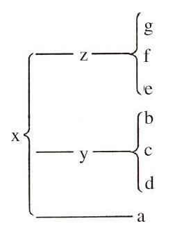

# 卷十五 一八、论校勘之学

> 卷十五（1917）　序号 938 / 1006　来源: [https://www.xuges.com/xdmj/hushi/lx4/018.htm](https://www.xuges.com/xdmj/hushi/lx4/018.htm)

---

（十二月廿六日）

校勘古籍，最非易事。盖校书者上对著者下对读者须负两重责任，岂可轻率从事耶？西方学者治此学最精。其学名Textual
Criticism。今撷其学之大要，作校书略论。

（一）求古本。愈古愈好。

（1）写本（印书发明之前之书）。

（2）印本（印书发明之后之书）。

若古本甚众而互有异同，当比较之而定其传授之次序，以定其何本为最古。其律曰：

凡读法相同者，大概为同源之本。

今为例以明之。如某书今有七本互为异同。七本之中，第一本（a）与他本最不同，其次三种（b c d）最相同，又次三种（e f
g）最相同。如此，可假定此七本所出盖本于三种更古之本（如图）。若以b c d三本相同之处写为一本，则得y本；更以e f g相同之处写为一本，则得z本。更以y z
a三本相同之处写为一本，则得x本。x本未必即为原本，然其为更古于a b c d e f g七本则大概可无疑也。

（二）求旁证。

（1）丛钞之类。如马总《意林》，及《北堂书钞》《群书治要》《太平御览》之类。

（2）引语。如吾前据《淮南子》所引“美言可以市尊，美行可以加人”，以正王弼本《老子》“美言可以市，尊行可以加人”是也。

（3）译本。

（三）求致误之故。

（甲）外部之伤损：

（1）失页（2）错简（3）漶灭

（4）虫蛀（5）残坏

（乙）内部之错误：

（1）细误。

（a）形似而误。如墨经“

”误“恕”，“宇”误“守”，“字”误“宇”，“冢”误“家”是也。

（b）损失笔画。如吾前见《敦煌录》中“昌”作“

”，“害”作“

”之类。

（c）损失偏旁。

（2）脱字。

（a）同字相重误脱一字。

（b）同字异行，因而致误。如两行皆有某字，写者因见下行之字而脱去两字之间诸文。

（c）他种脱文。

（3）重出。

（4）音似而误。

（5）义近而误。

（6）避讳。如《老子》之“邦”字皆改为“国”，遂多失韵。

（7）字倒。

（8）一字误写作两字。

（9）两字误写成一字。

（10）句读之误（文法解剖之误）。如《老子》“信不足，焉有不信”，“焉”作“乃”解。后人误读“信不足焉”为句，又加“焉”字于句末。（见王氏《读书志馀》）

（11）衍文（无意之中误羡）。

（12）连类而误。写者因所读引起他文，因而致误。

（13）旁收而误。旁收者，误将旁注之字收作正文也。例如，《老子》三十一章注与正文混合为一，今不知何者为注为正文矣。又如，《孟子》“必有事焉而勿正心勿忘勿助长也。”或谓“勿正心”乃“勿忘”之误，此一字误作两字之例也。吾以为下“勿忘”两字，乃旁收之误。盖校者旁注“勿忘”二字，以示“勿正心”三字当如此读法。后之写者，遂并此抄入正文耳。

（14）章句误倒。此类之误，大概由于校书者注旧所捝误于旁。后之写者不明所注应入何处，遂颠倒耳。

（15）故意增损改窜。此类之误，皆有所为而为之。其所为不一：

（a）忌讳。如满清时代刻书恒去胡虏诸字。又如，历代庙讳皆用代字（上文6）。

（b）取义。写者以意改窜，使本文可读而不知其更害之也（上文10）。

（c）有心作伪。

校书以得古本为上策。求旁证之范围甚小，收效甚少。若无古本可据，而惟以意推测之，则虽有时亦能巧中，而事倍功半矣。此下策也。百余年来之考据学，皆出此下策也。吾虽知其为下策，而今日尚无以易之。归国之后，当提倡求古本之法耳。
