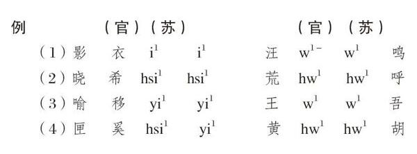

# 卷十五 五三、赵元任辨音

> 卷十五（1917）　序号 973 / 1006　来源: [https://www.xuges.com/xdmj/hushi/lx4/053.htm](https://www.xuges.com/xdmj/hushi/lx4/053.htm)

---

（三月廿日）

赵元任前来书云（去年十月廿三日）：

一、凡影纽之字，皆以韵起，或以喉端音起（喉端音者〔Glottal stop〕，如德文之ein）。其字皆属上声。（此上声，指上平，上上，上去，上入，非仅第二声也。）

二、凡晓纽之字，皆以“h”（或后“ch”）起。其以“y”及“ü”为介者，以“hy”（或前“ch”即“hs”）起。其字皆在上声。

三、凡属喻纽之字，皆以韵起。其字皆在下声。（下声指下平，下上，下去，下入。）

疑凡喻纽之字，本以w y ü三介之一发端。其前无纽音，故此三介皆成韵也。

〔注〕

有数种方言，其喻纽之字皆读以“ng”（疑）发端。其影、匣二纽则不然也。

四、匣纽之字，在江浙则以有音之“h”（孩）或“y”起，在官话则以“h”或“hs”起。其字皆属下声。

原书为英文，此吾所译也。

〔适按〕元任此说辨之甚精。惟其论喻纽下一注，有未尽然者。盖影纽以韵起之字，在各方言中亦有以“ng”起者，如

（上平）哀，安，恩，谙，欧，鸦，在吾徽则读如Ngai，Ngan，Ngun，Ngau，Ngeu，Ngo。

（上去）爱，懊。

（上上）蔼，蚁。（此疑是下上）

（上入）恶，鸭。

则不独喻纽为然也。适意以为古代疑纽之字上声为影，下声为疑，疑又变为喻耳。

因论蚁字，连类记此。吾徽无“上上”“下上”及“上入”“下入”之别，仅有六声耳。今惟广州有八声，其他则至多仅有七声耳。（如秦音能别“上入”“下入”，而不能别“上去”“下去”，又不能别“上上”“下上”也。福州虽有八声，其“上上”“下上”实已无别，但存其名耳。）

元任辨音最精细，吾万不能及也。
