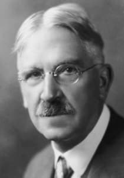

# 卷十六 八、杜威先生小传

> 卷十六（1917）　序号 982 / 1006　来源: [https://www.xuges.com/xdmj/hushi/lx4/062.htm](https://www.xuges.com/xdmj/hushi/lx4/062.htm)

---

杜威先生像

此小传见于三月廿六日《独立》周报，作者为Edwin E. Slosson（爱德华·斯劳森）。

If some historian should construct an intellectual weather map of the United
States he would find that in the eighties the little arrows that show which way
the wind blows were pointing in toward Ann Arbor, Michigan, in the nineties
toward Chicago, Illinois, and in the nineteen hundreds toward New York City,
indicating that at these points there was a rising current of thought. And if he
went so far as to investigate the cause of these local upheavals of the academic
atmosphere he would discover that John Dewey had moved from one place to the
other. It might be a long time before the psychometeorologist would trace these
thought currents spreading over the continent back to their origin, a secluded
classroom where the most modest man imaginable was seated and talking in a low
voice for an hour or two a day. Knowing that every biographer is expected to
show that the got his peculiar talents by honest subject of his sketch
inheritance I wrote to Professor Dewey to inquire what there was in his
genealogy to account for his becoming a philosopher. His ancestry is
discouraging to those who would find an explanation for all things in heredity.

My ancestry, particularly on my father's side, is free from all blemish. All
my forefathers earned an honest living as farmers, wheelwrights, coopers. I was
absolutely the first one in seven generations to fall from grace. In the last
few years atavism has set in and I have raised enough vegetables and fruit
really to pay for my own keep.

John Dewey was born in Burlington, Vermont, october 20, 1859, the son of
Archibald S. and Lucina A. (Rich) Dewey. His elder brother, Davis Rich Dewey, is
professor of economics and statistics in the Massachusetts Institute of
Technology and the author of the Special Report on Employees and Wages in the
12th Census as well as of many other works on finance and industry.

John Dewey went to the State University in his native town and received his
A.B. degree at twenty. Being then uncertain whether hisliking for philosophical
studies was sufficient to be taken as a call to that calling he applied to the
one man in America most competent and willing to decide such a question, W. T.
Harris, afterward United States Commissioner for Education, but then
superintendent of schools in St. Louis. Think of the courage and enterprise of a
man who while filling this busy position and when the war was barely over
started aJournal of speculative philosophyand founded a Philosophical Society
and produced a series of translations of Hegel, Fichte and other German
metaphysicians. It would be hard to estimate the influence of Dr. Harris in
raising the standards of American schools and in arousing an interest in
intellectual problems. When young Dewey sent him a brief article with a request
for personal advice he returned so encouraging a reply that Dewey decided to
devote himself to philosophy. so, after a year spent at home reading under the
direction of Professor Torrey of the University of Vermont, one of the old type
of scholarly gentleman, Dewey went to Johns Hopkins University, the first
American university to make graduate and research work its main object. Here he
studied under George S. Morris and followed him to the University of Michigan as
Instructor in Philosophy after receiving his Ph. D. at Johns Hopkins in 1884.
Two years later he married Alice Chipman of Fenton, Michigan, who has been ever
since an effective collaborator in his educational and social work. In 1888 he
went to the University of Minnesota as Professor of Philosophy but was called
back to Michigan at the end of one year.

When President Harper went thru the country picking up brilliant and promising
young men for the new University of Chicago, Dewey was his choice for the chair
of philosophy. During the ten years Dewey spent on the Midway Plaisance he had
the opportunity to try out the radical ideas of education of which I have spoke.
In 1904 Dewey was called to Columbia University where he has since remained.

〔中译〕

如果历史学家要建立一幅美国知识分子气象图，他将发现八十年代的风向标将指向密执安的安阿伯；九十年代指向伊利诺斯州的芝加哥；二十世纪初指向纽约。风向标位置的移动表明在每个转折点上思想都有一个上升潮。如果他进一步探究学术气氛在当地产生剧变的原因，他就会发现那是因为约翰·杜威从一个地方走到了另一个地方。心理气象学家追踪这些思想潮流流遍整个大陆，历经多时才回到它的起源地，那是一间僻静的教室，有一个你所能想象的最为谦虚的人坐在那里，用低沉的嗓音每天授课一两个小时。

人们都希望每一个传记作家能描述其传主如何从他的祖先那里承继特殊的才能，于是我便写信给杜威先生，向他了解他的家系中的那些使他成为哲学家的原因。这项工作的结果却表明，他的先祖们定会使那些想从遗传中找到答案的人大失所望。

我的先祖，特别是父系方面，简直无懈可击。所有我父系方面的先祖都身为农夬、修车匠、制桶匠等，过着诚实无欺的生活。七代人中我是第一个失去这种天恩的人。后来几年，返祖现象出现了，我靠种植大量的蔬菜和水果来维持自己的生计。

约翰·杜威，阿奇博尔德·S·杜威和卢西娜·A·里奇的儿子，1859年10月20日生于佛蒙特州伯灵顿。他的长兄，大卫·里奇·杜威是麻省理工学院的经济学和统计学教授，《第十二次人口调査中雇工和工资状况的特别报导》的作者。他还写过多种有关金融和工业的著作。

杜威在他的家乡上了州立大学，并在二十岁那年获得了文学士学位。由于他对这一点拿不定主张：即他对哲学研究的喜爱是否已到使他将其作为一项事业来献身的程度，他便向当时美国最有能力并愿意为他解答问题的人求教。这个人便是当时的圣路易学校的学监、后来的美国政府教育专员W·T·哈里斯。哈里斯在完成繁忙职务的同时，还创办了一家《思辨哲学》刊物，建立了一个哲学学会，并翻译了一系列黑格尔、费希特以及其他德国形而上学家的著作，而当时大战尚未结束，从中我们可以想见他是一个富有强烈事业心、积极进取的人。哈里斯博士在提高美国中学的水平及引起公众对知识的兴趣方面所产生的巨大影响是无法估量的。年轻的杜威给他寄去一篇简短的论文，征求他的建议，他的答复是如此的令人鼓舞以致杜威下定决心从此献身哲学。此后，杜威在佛蒙特州立大学托里教授（一位老学究）的指导下在家中读了一年书，然后便去了霍普金斯大学。这是当时美国第一所既授予学位又进行主要课程研究的大学。在这里他师从乔治·S·莫里斯，并在1884年获得哲学博士学位后跟随莫里斯去了密执安大学担任哲学讲师。两年后，他与密执安州芬顿的爱丽丝·奇普曼成婚，她一直是杜威的教学和社会工作的很好的合作者。1888年他去明尼苏达大学担任哲学教授，但不到一年便被重新召回密执安。

当芝加哥大学校长哈泼为新成立的芝加哥大学遍访出色有为的青年时，杜威被选中担任哲学教学方面的工作。在Midway
Plaisance度过的十年时间中，他有机会研究出了他的关于教育的基本学说，这个学说我在前面已经提及。1904年，杜威被邀请至哥伦比亚大学，并一直在那里工作到现在。
