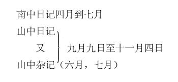
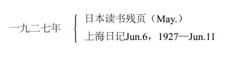

# 1950年3月10日

> 序号 021 / 235　来源: [https://www.xuges.com/xdmj/hushi/twrj/021.htm](https://www.xuges.com/xdmj/hushi/twrj/021.htm)

---

于焌吉大使从台湾回任罗马，又飞来纽约。孟真托他带来我的日记四包，最可感激！

日记存目如下：

一九二三年四月一日至十日

一九二三年（十二月十六日）至一九二四年（一月廿七）

自定年谱（1923）

一九二五年南行杂记（九月）

一九二六年Jul·17—Aug·20（《欧游日记》）

《欧洲日记》（二）Aug·20—SeP.18，1926

《欧洲日记》（三）SeP.19—Dec·8，1926

《欧洲日记》（四）Dec·9，1926—Feb·5，1927

（1927—1930日记似存在台北？看Mar·18记）

一九三〇年SeP.&Oct·

一九三〇年Nov·&Dec·

一九三一年（廿年）Jan·—Mar·

一九三一年Apr·—Nov·20

一九三二年南行日记（Nov·25—Dec·7）

一九三三年Mar·&May 28

一九三三年出国记（Jun·11—Jul·7）&（Oct·12—13）

一九三三年Nov·残

一九三三年Dec·
