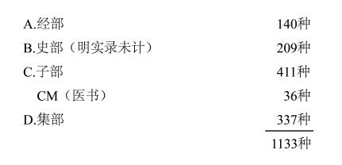

# 1950年10月16日

> 序号 058 / 235　来源: [https://www.xuges.com/xdmj/hushi/twrj/058.htm](https://www.xuges.com/xdmj/hushi/twrj/058.htm)

---

葛思德东方书库在一九四五至一九四六年曾请王重民先生去编一个善本书目。时间太匆匆，他只能将原草本留交葛思德东方书库。我曾翻看几次，到今天，匆匆点数重民认为“善本”的总数：

此中只包括一小部分明刻佛典。重民尚有单页几张，如《永乐大典》二卷，如《明实录》残存本。总计重民的善本目所收一千一百四十种。

葛恩德东方书库收有旧刻佛经几千册（折子本），我曾抽点几十函。其中最可宝贵的宋末元初“平江路碛砂延圣寺”刻的藏经，即所谓“碛砂藏”。向来记载碛砂板《藏经》的，说刻经起于绍定四年（1231），迄于武宗至大二年（1309）。我近来查得《十诵律》卷卅三（存三）有“碛沙延圣寺比丘志颐情旨：伏自行年庚戍（至大三年，1310？），五十七岁，七月初二日建生，发心施中统钞伍伯锭，助开本寺大藏板，流通圣教……”这里还有“庚戍”
