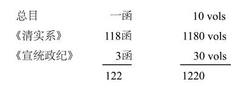

# 1952年1月13日

> 序号 131 / 235　来源: [https://www.xuges.com/xdmj/hushi/twrj/131.htm](https://www.xuges.com/xdmj/hushi/twrj/131.htm)

---

今天房杜联喆夫人与他丈夫房兆楹先生把全部《大清历朝实录》搬到我寓中。计有：

我此次决定买此大书（计价$700.00），是感觉此书有用，而我知道这三百年的史实太少，所以想到这书在我手头也许可以引起我读清史的兴趣。
