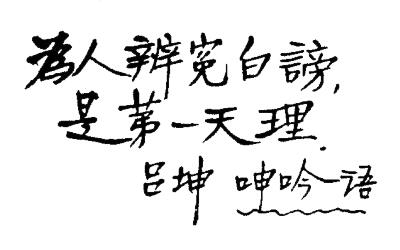

# 1952年7月29日

> 序号 171 / 235　来源: [https://www.xuges.com/xdmj/hushi/twrj/171.htm](https://www.xuges.com/xdmj/hushi/twrj/171.htm)

---

毛子水曾引此语，我甚喜之。因此我曾重读《呻吟语》两遍。

近日买得《丛书集成》零本两百多本，其中有《吕语集粹》，竟无此语。故大写在这里。

今天上午十点去请C·F·福克纳检查身体。他说，我的脉总是不规则的，须戒绝纸烟。我的体重（157磅，连鞋子裤子）应减去十磅到十五磅。他劝我注意饮食，我决意依他的“食单”试行。
