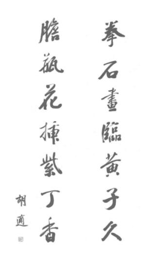

# 1952年12月17日

> 序号 198 / 235　来源: [https://www.xuges.com/xdmj/hushi/twrj/198.htm](https://www.xuges.com/xdmj/hushi/twrj/198.htm)

---

四十五年前的胡适

——祝胡适先生六十二寿诞

龚选舞

当罗家伦先生发现了胡适之先生四十五年前的白话作品时，他非常高兴地去告诉了他的老师。

“这不过是小孩子时代的玩意罢了。”胡先生笑了笑，自谦地回答说。当然，就六十二岁的寿翁言，十七岁时的作品，也许是小孩子的玩意；可是，远在四十五年后的今天，当我们再一次展读这几本胡先生主编的《竞业旬报》时，我们却依然为之神往。

令人神往的，不仅是胡先生早期就显露出来的天才，也不仅是他气势逼人的文采，而是这些作品内已经孕育了的至今仍然是崭新的见解。这就是说，十七岁的胡先生和六十二岁的胡先生，除了鬓边的几茎白发外，在思想和精神上，是一贯的、不变的，尽管有着成熟与否的差别。

四十五年前，胡先生正是个倜傥不群的少年，置身于一个列强环伺的古老帝国，他提倡爱国、反清，一脑子充满了对于旧的传统的怀疑与敌意。终于，他非正式地参加了一群革命党人主办的刊物，用他自称的一管秃笔，吐露出惊世骇俗的新思想，写作出地道白话的好文章。

从罗家伦先生仅能自本党党史编纂委员会找到的五本《竞业旬报》里，我们可以检出来十五篇胡先生的大作，这些作品散见在逊清光绪三十四年（戊申）在上海发行第二十五、二十八、三十四等期的《旬报》里，其中包括社说、时评、谈丛、论说、格言、传记、诗词、杂俎和小说。

这些以适、骍、适之、铁儿、适厂等名义发表的作品，除了一两篇旧诗和古文外，十九都是以极通俗的白话写成，距离他正式推动新文学运动的时间，约计是十年以上。

没有党籍的革命志士

谁都知道四十五年前做革命党是要杀头的，可是，这位“没有党籍的少年革命志士”却一面在中国公学做学生，一面主持由萍乡、醴陵籍革命党人创办的革命刊物。

这位少年革命志士的文章，轻松中尽显锋芒，流畅里蕴藏奇气，从字里行间，更孕育着他此后逐渐发展而成的有系统的思维。

“科学”“民主”与“自由”

首先，我们可以从这些刊物里，发现出少年的胡先生对于旧的传统，十足地怀着怀疑与敌意：

“……尝慨夫吾国先圣格物致知之说，乃为宋儒‘物犹事也’一语所误，其遗毒遂致我神州民族科学思想堕落无遗，其有稍涉于此，则又以‘玩物丧志’四字一笔抹杀，嗟夫，物理之不明，则日日讲道德说仁义，而于生民之涂炭，群氓之蚩蚩，终无丝毫之益，所谓独善其身者非耶？……”（《旬报》第廿八期，“适之”作《无鬼丛话》）

“现在上海出了一部极好极有益处的小说，叫做《爱国二童子传》，那书真好，真可以激发国民的自治思想、实业思想、爱国思想……兄弟看那书里面，有许多极好的话，遂和那些格言相仿佛，便抄了一些来给大家看。兄弟的意思，这些格言，比那朱子的治家格言好得多多呢！”（同书“适”作《读爱国二童子传》）

“自由之国民，惟开诚布公，可以治之。”（《旬报》三十四期“铁儿”译《金玉之言》）

大家都知道“五四”运动的胡先生是大声疾呼欢迎“德先生”与“赛先生”的，可是，从上面所录三节胡先生的早期作品里，我们却可以证明远在“五四”的十年以前，十七岁的胡先生已经在拿“科学”、“民主”与“自由”来对抗古老的传统了。

今天，这些信条依然是胡先生思想的精髓，所以，我们仍然觉得胡先生是一贯的年轻的。

炽热的爱国情操

其次，我们可以发觉出少年的胡先生，满怀着炽热而纯洁的爱国情操：“我们的父母，生我育我，我们的兄弟爱我助我，所以我爱他们。难道我们的祖国，保护我，教育我，我们倒可以忘记了他吗？倒可以不爱他吗？所以我第一句话就说国是人人都要爱的，爱国是人人本分的事……”（《旬报》三十期“铁儿”作《爱国》）

“爱国的人，第一件要保存祖国的光荣历史，不可忘记。忘记了自己祖国的历史，便要卑鄙龌龊，甘心做人家的牛马奴隶了……”（同上）

“男子首宜爱国，方为尽分。”（《旬报》廿八期“适”作《读爱国二童子传》）

四十五年前，胡先生为了爱他的祖国，他不惜主持革命刊物，冒着被清帝抓着杀头的危险。事实上，《旬报》的另一主持人杨卓林先烈就是被两江总督端方捕杀的。

此后的年代里，胡先生更一直没有忘记他的祖国，这位被罗家伦先生称为“没有党籍的革命志士”，他的一生，可不就一直保持着这个身份？

四十五年前的白话文

再次，我们更可以从这十五篇作品里，发现这位“五四”举起文学革命大纛的大师，在十七岁时，已经熟练而普遍地运用白话文。

连续在《旬报》刊载十期的长篇小说《真如岛》，是用《水浒传》似的白话文写成的，在仅能找到的三期《旬报》中，我们看出胡先生以徽州作背景，姓胡的人物为主角，轻松地描绘出当时徽州的风俗，深刻地刻画出当时的可爱人物，而且更用他的泼辣的“秃笔”，痛斥迷信，打击神佛。这种大胆的作风，现在是家常便饭，当日却说得上是惊世骇俗的。

此外，如二十八期的社说《婚姻篇》，二十五期社说《论毁除神佛》，时评《中国的政府》，三十四期的社说《爱国》，论说《对于中国公学风潮之感言》，谈丛《读〈汉书〉杂记》等，都是以流利而泼辣的白话文写成，今天本报副刊刊出的《杨斯盛传》，就是胡先生早年以白话文写作的一例。

另外一件值得注意的事，是在这些早期作品中，胡先生虽然还没有想到利用句点、逗点等成套的新式标点，但是“——”一类的引号，却已经多次运用。这和他后来的提倡新式标点恐怕不无关联。

生日的礼物

今天，刚巧是胡先生六十二岁的生日，能够让鬓发已斑的胡先生重温一下少年时代的记忆，我想是对于这位一代学人最好的礼物。

最后，我们得感谢罗家伦先生，为了找寻这几本四十五年前的革命刊物，使他仆仆风尘地奔波在台北与台中道上，最后，才好不容易地从党史会偌大的书库里，辛苦地检出这几本珍贵的刊物来。

中国第一伟人杨斯盛传

——胡适之先生十七岁时作

兄弟现在又要说一位大豪杰了。这一位豪杰，空了双手，辛辛苦苦，做了几十年，积了几十万家私，到了老来，一一地把家私散了大半。来得艰难，去得慷慨。这种人，兄弟要是不来表扬表扬，兄弟这支笔可不是不值钱了么！

这人姓杨，名斯盛，字锦春，是江苏川沙厅人氏。从小父母双亡，无力读书，不但无力读书，差不多连饭都没得吃了，后来只好做一个泥水匠，赚两文钱度度日。看官，我中国的人，有一种怪习气，越是做下等劳动的人，越流落得快。因为生来不大吃得苦，稍吃些苦，便腰驼背胀的了，只好吃两分鸦片烟，喝两口酒，或是买点好小菜，一天辛苦钱，还不够一餐吃喝，哪里还会成家立业呢？看官要晓得，这“穷苦”二字，真是一块试金石，随你什么人，须要经过这个关头，才有后来的指望。唉！这些脓包男子哪里经得这块试金石的摩擦，只有我如今所说的“杨斯盛”先生，不震不惊、从容不迫地跳过了这个关头，睁开了眼睛料事，立定了脚跟吃苦，驼起了肩头做工，如此者十几年，才有了立脚之地。回想起初到上海的时候，年纪才得十三岁，那一种孤苦伶仃的景况，真个如同梦境了。

杨斯盛先生，有几种本事：第一样天资极高，他原是没有读过书的，后来不但能读中国书，并且能说英国话了。第二样见识甚好，办事极有决断。有了这二种本事，办事自然容易。再加以一种坚忍的气概、独立的精神，自然天下无难事了。于是乎不上三十年中，杨斯盛已成了大富翁了。列位，你不看见中国的富翁吗？一生奸刁诈伪地赚了个把家私，便说道老夫的家私是血汗心力去换来的，如今是要省吃省用地用去才可留下来传给子孙。所以这种人心目中只认得黄的金子、白的银子，哪里敢轻用一钱。哈哈！只好留给他子孙把去孝敬那烟馆老板堂子乌龟吧！但是我所说的这位杨先生，却不是这种人，他要是这种人时，他那家私可不知要积到多少万了。但一生一世，遇了什么天灾人事，务必捐出巨款，赈济受害的人；遇了什么公益事业，务必出钱捐助，他生平捐钱造的马路也不知多少条，救活了的人也不知多少人了。他所做的事业，最为人所最崇拜的就是那“破家兴学一事”。

杨先生因为自己少时没有读过多少书，所以他很想造就一班少年人才出来，所以他便捐了十万金开一所广明小学，并附设一个师范传习所。后来渐渐扩充，便改为浦东中学，附设两等小学，筑校舍于上海对面之浦东。那学堂中如今已有了二三百人，其中规模之宏大，办法之整严，就是上海开办了多少年的学校，也还不及。不料那学校开办不上二年，我们这位可敬可爱可师可法的杨斯盛先生，竟尔死了。可怜他死的时候，还说“那学校用的黑板要改良”，这句话还没说完便死了。唉！可怜呵！

他未死之前，便把家产分为数份。把所有家产的三分之二捐入那学校，以外的家产，捐助南市医院，改筑桥梁，捐助旁的学堂，还有许多事业，兄弟说也说不完了，余下给子孙仅十分之一耳。看官，这种人是一种什么人？兄弟说的豪杰二字，能够包括得完全吗？我们中国古时，有个人叫做疏广，他说：“子孙若贤，多了钱，便不用功上进了，便灰了他的志向了。子孙若不贤，多了钱，便是助他作恶作歹了。”所以他有很多的黄金，都拿去办了酒食，日日请客人大吃大用，却不传给子孙。中国的人，几千年来，都称赞他的好处。看官，他所说的话可是不错，但是他行的事却大错了，他不拿钱去做些济人利物的事，却拿去大吃大喝。一来呢，独乐一身，无益于天下生民。二来呢，饮食醉饱，给子孙做一个败家的榜样，他那里比得上我们这位可敬可爱可法可师的杨先生呵！唉！兄弟这个话，如何可拿去责备几千年前的古人，他哪里懂得，只好把来希望列位看官吧。

四十五年前胡适的作品

今天是胡适之先生的六十晋二诞辰，中副能找到他在四十五年前的一篇早期作品，（《中国第一伟人杨斯盛传》——原文见右角）加以刊载，一方面作为一种诚意的纪念；另一方面也是一个非常珍贵的发现，我们感到十分的荣幸。

这是一篇完全用白话文写成的传记，当胡先生写作时，他还仅仅是一位十七岁的少年，而今，他的鬓边却平添了不少的白发。不过，胡先生并没有老，从他这篇最早的白话文创作里，大家都可以看出来。

胡先生这篇作品，是刊登在革命党人主办的《竞业旬报》第二十五期上的，时间是光绪三十四年阴历的八月初一日。那时候，这位年轻的主编，正在上海中国公学一方面做学生，一方面又兼做先生，教授英文。

感谢罗家伦先生，由于他的帮助，使我们能够看到这篇提倡白话文的大师的先期作品。（舞）

