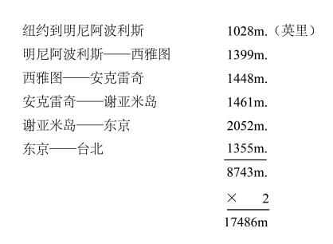

# 1953年1月25日

> 序号 207 / 235　来源: [https://www.xuges.com/xdmj/hushi/twrj/207.htm](https://www.xuges.com/xdmj/hushi/twrj/207.htm)

---

下午三点到纽约埃德怀特机场降落，冬秀与刘锴大使、游建文夫妇、缪云台夫妇、刘驭万、严文郁、童世纲、汪振寰一家……都在场接我。

此行共七十日（Nov·16，1952—Jan·25，1953），走了17486英里。其路程如下：

