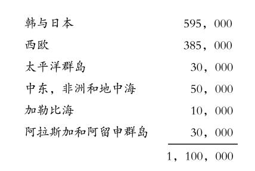

# 1953年9月20日

> 序号 228 / 235　来源: [https://www.xuges.com/xdmj/hushi/twrj/228.htm](https://www.xuges.com/xdmj/hushi/twrj/228.htm)

---

前引富尔顿·小刘易斯的，美国军队分驻在四十九国，（Aug·5）。

今天《纽约时报》有一图表，分析如下：

美国兵力 3，500，000

驻国内 2，400，000

国外 1，100，000

其重要地域如下：

刘易斯所说四十九国当是包括一切的基地及军事代表团的国家。
