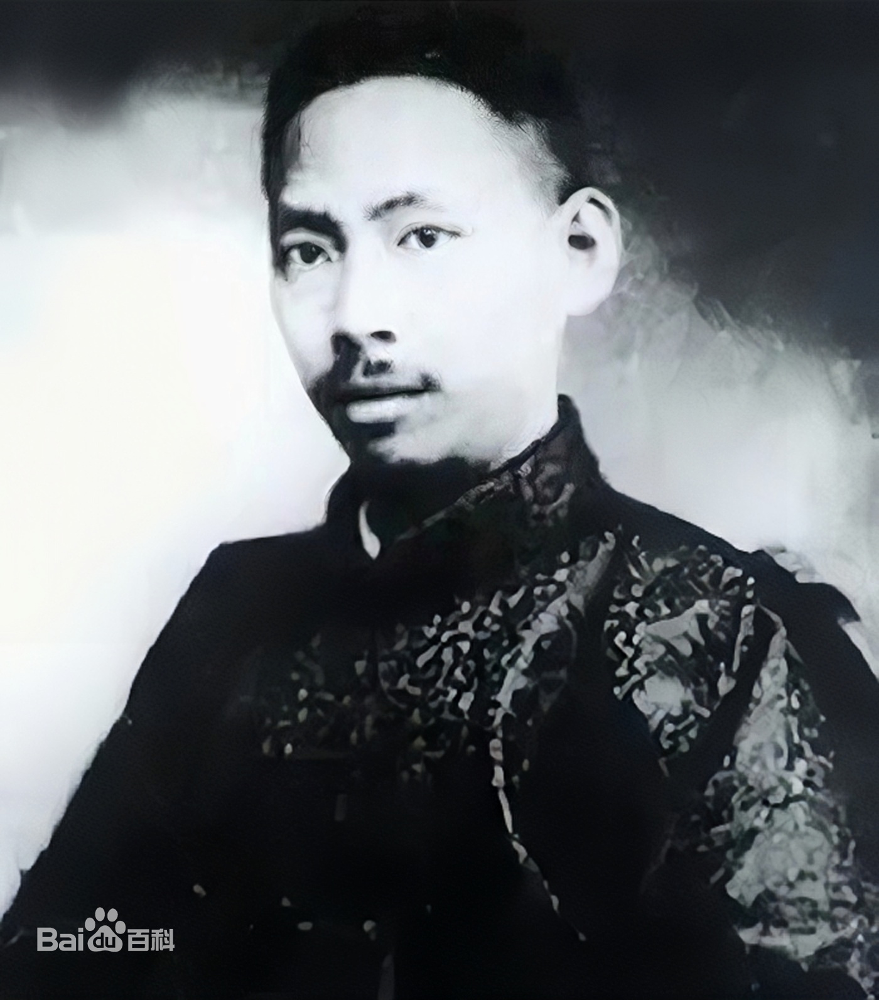

# 胡适日记——杨杏佛终尝恶果1930.02.01

> 辑补卷 · 1930-02-01　序号 3 / 69
> 来源（网络连载转抄，二手来源）：[https://www.bilibili.com/read/cv22660156](https://www.bilibili.com/read/cv22660156)

---

胡适日记——杨杏佛终尝恶果1930.02.01

政府中有人近來很和中央研究院爲難。

院中去年得文化基金董事會允撥五十萬元爲理化工程研究所的建築費，建築工程即將開始。上月中央政治會議忽决議令研究院停止建築工作，務須遷到南京。杏佛奔走多次，——十四日之中，往返南京、上海八次！——行政院與國民政府方面已疏通好了，呈覆到政治會議，忽然蔣介石自己主席，力主令研究院将所有研究所一律於四月以前遷到南京，建築工程立即停止，進行中的一切設備均於四月前遷往南京。
此令昨日到研究院。蔡楊諸君在前年屢次用政府勢力壓迫學術文化機關，而自己後來終想造成一個不受政府支配的學術機關，此是甚不易做到的事。果然今日自己受威力壓迫！而杏佛的語氣似是想用他前年極力摧殘的中華文化教育基金會來替他搪塞！此真是作法自斃。但政府中人借研究院來報復蔡先生不合作的態度，更屬可恨。
今日我去看蔡先生，勸他不要輕易放棄，須力争學術團體的獨立。
然此事殊不容易做。歐洲各大學在中古時皆有特殊保障，略似一種治外法權，故能不受宗教勢力與政治勢力的壓迫。此種保障雖不完全有效，然究竟保全不少。其最重要者爲每一學術機關皆有一種「憲章」(Charter)，在此憲章頒與之後，一切憲章範圍以内的事，皆不受外力的干涉。如文化基金會之章程，即是當日政府頒與的憲章也。此章程內的要點是董事缺額自行選補。此點一破壞，則此會根本失其獨立之權。今研究院的組織法第一條說，「國立中央研究院直隸於國民政府」；第三條云，「院長一人，特任」；經費來源又每月由財政部頒給。其中全無一點保障可以使政治勢力不來干涉。故甚不易争得獨立的地位。

