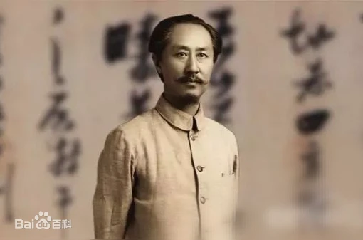

# 胡适日记——点评李石曾1930.02.09

> 辑补卷 · 1930-02-09　序号 4 / 69
> 来源（网络连载转抄，二手来源）：[https://www.bilibili.com/read/cv22657607](https://www.bilibili.com/read/cv22657607)

---

胡适日记——点评李石曾1930.02.09

中華文化基金董事會開第四次常會，在礼查飯店。到者蔡（元培）、蒋（梦麟）、李（石曾）、趙（元任）、孫（科）、任（鸿隽）、翁（文灏）、Greene（顾临）、Baker（贝克）與我，共十人，有三分之二，可算盛會。

此次無甚重要議案。有一案爲「聯合各文化基金團體保存北平古物」，李石曾提議，要合籌四百萬元，一半保存北平古物，一半用在南京「創造文化機關」！

此人毫無常識，毫無思想，而居然有人尊信，豈非一大怪事！  我第一次見石曾，便不喜他；第二次見他，便同他作對（為里昂大學、北大海外部事)。十年以來，無有一次看得起此人的。蔡先生費大力引他入北大，終使北大壞在他手裡，真是引狼入室。

*        *        *

以后，在1961年12月23日，胡适与他的秘书胡颂平谈起：  “李宗侗是河北高阳李鸿藻的孙子。李石曾是鸿藻庶出的儿子。李宗侗是易培基的姑爷。......冯玉祥逼宫之后，易培基他们组织‘故宫博物院’。他们一班人都是反对我的，要在故宫里找寻我的劣迹，说我私通宣统。他们搜查的结果，发现我给宣统的一张片子，上面写了‘我今天有课，不能进宫，乞恕’几个字，他们配起一个镜框，挂在故宫里作为展览品。我曾到故宫博物院去看过。我问可以照相吗？他们说不可以；因此就没有这张片子的照相。......”

1962年元旦，胡适在《清史稿》上看见金梁的序文，又对胡颂平说：“金梁是清室的内务府大臣，他密谋复辟的文件中有举贤才的奏摺。在这个奏摺中劝溥仪应该罗致人才的，其中有我的名字。这些奏摺，溥仪存在养心斋里，十四年七月三十一日被故宫委员会发现。这是李石曾们要找寻我的劣迹，还有我的一个名片。金梁是满洲人，他在民国十七年写的序文，避免民国的字样，只写‘戊辰端午’。他的奏摺，你可以到史语所图书馆查查看。”

