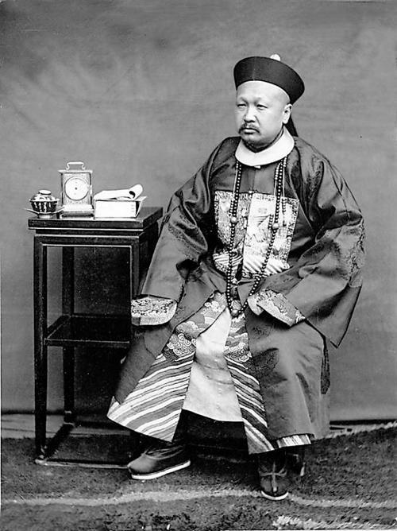

# 胡适日记——第一次坐飞机1930.02.20

> 辑补卷 · 1930-02-20　序号 6 / 69
> 来源（网络连载转抄，二手来源）：[https://www.bilibili.com/read/cv22644548](https://www.bilibili.com/read/cv22644548)

---

云南飞行司令刘沛泉（毅夫）先生邀我去试坐飞机，我們乘的是沪蓉四号，同行者有岑春煊先生，年七十；王人文先生，年六十八；刘君与我，共四人。计在空中约十二分钟，在上海顶上打了一个旋转，据说高约三千多尺。这是我第一次飞行，毫不觉困苦，只有机器声太闹，耳膜有点震动，下来后还觉得一点余音震耳。

岑云阶先生是第一次见面，脚微有不便，但尚健旺。

[图注] 岑春煊（1861年—1933年），中国近代史上著名政治人物。字云阶，号炯堂老人。
